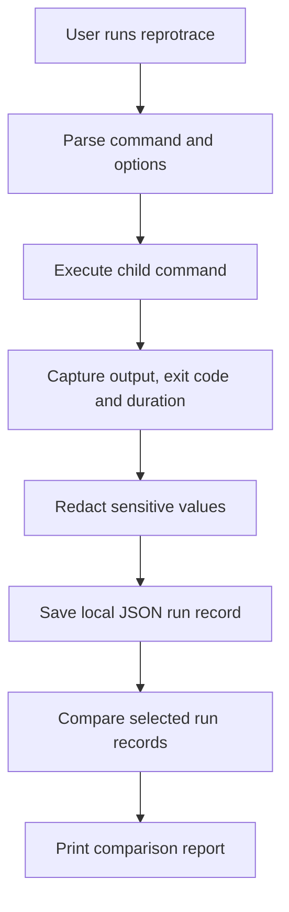

# reprotrace

> `reprotrace` is a proposed Linux-friendly command-line tool that records command-run evidence and helps compare a successful run with a failed one.

**Team:** Samiksha Pawar (Roll No. 19), Aditee Sable (Roll No. 28)  
**Repository:** https://github.com/Samiksha17Pawar/REPROTRACE-cmd  
**Date:** 28-10-2026

---

## 1. The problem

When a build or test command behaves differently between runs, developers often have to rerun it, search terminal history, and compare output manually. `reprotrace` aims to make this investigation easier by saving a structured record of each run and producing a comparison report.

### Evidence from our machine

Our development machine reports macOS on Apple Silicon, Python 3.14.6, and Git 2.54.0 (Apple Git-157). These checks confirm the development environment, but do not by themselves prove how often the target problem occurs. We still need to record a real example from our own command history or a controlled demonstration, along with its frequency and time cost.

```bash
uname -a
python3 --version
git --version
```

**Problem frequency and cost:** To be completed with an honest observation from our own work.  
**Who else experiences it:** To be checked by asking a classmate or teammate; no response is claimed yet.

## 2. Prior art — existing approaches

Tools already exist for recording command output and reproducing environments. This project does not claim that the general idea is new. The proposed focus is a small, local CLI workflow for saving two command runs and presenting their differences in one readable report.

| Existing tool or approach | What it can help with | What we need to verify |
|---|---|---|
| `script` | Records a terminal session | Whether the resulting transcript is easy to compare as structured run records |
| `diff` | Compares text files | How much manual preparation is needed to compare command runs consistently |
| Shell history (`history`) | Finds previously entered commands | It does not by itself preserve each run's output, duration, and exit status as one report |

These are research candidates, not yet claimed as installed and tested. The assignment requires at least three tools to be run and documented with actual commands, versions where available, output, and observations before final submission.

**Important prior-art note:** A web search also found a Python package named `RepoTrace` on PyPI that describes capturing command output and environment details, replaying runs, and comparing outcomes. This is a very close overlap with our current concept. We must investigate it and narrow or change our project scope before claiming a distinct gap. Reference: https://pypi.org/project/repotrace/

**Current gap hypothesis:** Basic tools can record sessions or compare files, while our intended workflow would organize selected command-run metadata and compare two saved runs in one report. This remains a hypothesis until the closest existing implementation is tested; we will not claim that no existing tool does this.

**Where we will search:** local manual pages (`man -k`), GitHub, Homebrew, Stack Overflow, PyPI, and feedback from a classmate or developer. Record searches and results after actually completing them.

## 3. What we are building

### In scope

- Capture the command and arguments, working directory, runtime duration, exit code, stdout, and stderr.
- Save run records locally in a simple structured format.
- Compare two saved runs and highlight meaningful differences in their status and output.
- Redact common secret-like environment values if environment metadata is collected.

### Out of scope

- Automatically fixing code or diagnosing every possible failure.
- Recreating complete containers or virtual machines.
- Uploading run data to a remote service; the initial design is local-first.

### How we will measure success

The prototype should capture a command's output and exit status, save the record, and compare two runs using a repeatable set of test cases. We will report the actual test results after implementation; we do not yet claim a measured time saving.

## 4. Tech stack

| Choice | Planned selection | Reason |
|---|---|---|
| Language | Python 3 | Familiar for the team and available on macOS/Linux |
| CLI parsing | `argparse` | Built into Python; no extra dependency required for basic commands |
| Command execution | `subprocess` | Supports running commands and capturing output and return codes |
| Storage | JSON files | Human-readable and easy to inspect for a small prototype |
| Testing | `unittest` or `pytest` | Allows repeatable success, failure, comparison, and redaction tests |
| Installation | Python package with a CLI entry point | Makes the command easier to install and run consistently |

We chose Python to keep the first version small and understandable. Pure Bash was considered, but structured records, redaction, and comparison reports are easier to maintain in Python. The implementation must still be tested on Linux; development on macOS alone does not prove Linux compatibility.

## 5. Architecture



| Component | Responsibility | Planned file |
|---|---|---|
| CLI | Parse `run`, `compare`, `list`, and `show` commands | `reprotrace/cli.py` |
| Runner | Execute command and capture output/status/time | `reprotrace/runner.py` |
| Storage | Save and load local JSON records | `reprotrace/storage.py` |
| Comparison | Compare metadata and output | `reprotrace/compare.py` |
| Tests | Check successful/failed commands and comparisons | `tests/` |

**Data flow:** The user supplies a command. The tool runs it as a child process, records selected execution details, redacts likely secrets, and saves a local record. The compare command loads two records and prints the differences.

| Failure case | Intended behaviour |
|---|---|
| Command cannot be started | Print a clear error and return a non-zero status |
| Record ID does not exist or cannot be read | Explain the problem without crashing or overwriting records |
| Output directory is not writable | Report the storage error and exit non-zero |

## 6. Usage

The following is the **planned interface**, not proof that the command is already implemented. Replace these examples and outputs with real results after building and testing the CLI.

### Synopsis

```text
reprotrace run -- COMMAND [ARGS...]
reprotrace compare RUN_ID_1 RUN_ID_2
reprotrace list
reprotrace show RUN_ID
```

### Planned examples

```bash
# Capture a successful command
reprotrace run -- python3 -c "print('hello')"

# Capture a failing command
reprotrace run -- python3 -c "import sys; print('failure'); sys.exit(1)"

# Compare two IDs returned by the run command
reprotrace compare RUN_ID_1 RUN_ID_2
```

**Expected behaviour to verify:** each run should show its ID and exit status; comparison should report differences in status and output. Do not paste invented output as actual evidence.

### Exit codes (planned)

| Code | Meaning |
|---|---|
| `0` | Tool operation succeeded; the captured command may itself have its own recorded exit code |
| `1` | Captured command failed or a comparison found a difference (final behaviour to define and test) |
| `2` | Invalid arguments, unknown run ID, or tool-level error |

The final implementation must define these consistently and update this table to match tested behaviour.

### Installation (after implementation)

```bash
git clone https://github.com/Samiksha17Pawar/REPROTRACE-cmd.git
cd REPROTRACE-cmd
# Follow the install command documented in the repository after it is implemented.
```

The repository URL was supplied by the team, but its current contents and accessibility have not been independently verified here. Test these instructions from a clean checkout before submission.

## 7. References

- Python `subprocess`: https://docs.python.org/3/library/subprocess.html — planned command execution and output capture.
- Python `argparse`: https://docs.python.org/3/library/argparse.html — planned command-line argument parsing.
- GNU `diff`: https://www.gnu.org/software/diffutils/manual/ — text comparison baseline.
- PyPI `RepoTrace`: https://pypi.org/project/repotrace/ — close prior art that must be evaluated before claiming a gap.
- GitHub documentation on cloning: https://docs.github.com/en/repositories/creating-and-managing-repositories/cloning-a-repository — repository checkout instructions.

---

**Before final submission:** replace the evidence placeholders with real observations; install and run at least three existing tools and include their actual output; investigate the close RepoTrace overlap and revise the scope if needed; implement and test this CLI; replace planned examples and exit codes with verified results; and test installation on Linux.
